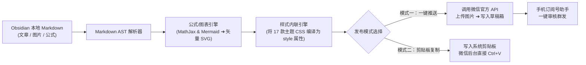

# WeChat MP Publisher — Obsidian 微信公众号排版与发布工作台 ✈️

<div align="center">

<a href="https://imaomyying.com/#/project/obsidian-wechat-publisher" target="_blank">
  
</a>

<br/>
<br/>

[](LICENSE)
[](https://obsidian.md/)
[](https://www.typescriptlang.org/)
[](https://mp.weixin.qq.com/)
[](#-17-款主题与-4-种模板体系)
[](#-安全与隐私承诺)

**打通本地知识库与微信生态的所见即所发一键排版工具**  
*本地 Markdown 直连微信草稿箱 · 17 款主题 × 4 种模板 · 公式图表矢量转 SVG · 零第三方云端中转*

---

### 🌐 [点击进入产品在线介绍展示页 (Live Interactive Showcase)](https://imaomyying.com/#/project/obsidian-wechat-publisher)
可在展示页内通过**逼真手机端模拟器**自由切换排版主题与模板，并体验**一键直推草稿箱的 5 步编译流水线**！

---

</div>

## 💡 为什么开发这款插件？

许多深度内容创作者和程序员都习惯在本地 **Obsidian** 中使用纯 Markdown 记录笔记、构思文章。但在将内容发表到微信公众号时，却面临巨大的鸿沟：
1. **直接粘贴排版彻底崩塌**：微信后台官方编辑器对原生 Markdown 支持极差，标题缩进变形、引用块丑陋、代码块丢失换行与高亮；
2. **第三方排版工具繁琐且存在隐私泄露风险**：市面上的云端排版编辑器需要把未公开的草稿全文上传到第三方服务器，有版权与敏感信息外流顾虑；
3. **配图与公式处理极度痛苦**：本地引用的图片需要一张张手动上传并替换，KaTeX / LaTeX 数学公式和 Mermaid 流程图更是无法直接粘贴显示。

**WeChat MP Publisher** 彻底打破了这道屏障——无需离开 Obsidian，在右侧原生工作台里：
- **所见即所发**：17 款高质感排版主题 × 4 种排版模板，实时在右侧渲染出手机移动端的最终效果；
- **一键直推草稿箱**：自动提取配图、公式、Mermaid 图表上传至微信永久素材库，并直接写入微信公众号后台草稿箱；
- **复制排版 (剪贴板模式)**：即使不配置微信 API，也能一键复制带完整内联 CSS 的富文本，在公众号后台 `Ctrl/Cmd+V` 秒级排好！

> 💡 **提示**：自 v0.2.0 起插件 ID 规范命名为 `wechat-mp-publisher`，支持与旧版插件并行共存，老用户数据无缝平滑迁移。

---

## 🎨 17 款主题与 4 种模板体系

插件内置由资深自媒体人与排版设计师联合调优的丰富样式：

```
[微信排版主题方案]
 ├── 🌿 优雅清新系列：薄荷绿、森林绿、初春浅草
 ├── ⚡ 科技极客系列：经典邃蓝、赛博霓虹、GitHub 暗调
 ├── 🏮 东方美学系列：雅致朱砂、黛蓝青瓷、故宫朱红
 ├── 🖤 现代极简系列：黑白报刊、瑞士平面、极简无衬线
 └── 🎨 莫兰迪艺术系列：薰衣草灰、温润米纸、复古暖棕
```

### 四大排版模板结构
1. **📑 深度长文模板**：清晰的 01 / 02 编号分级标题、金句引用块、重要结论 Callout 容器；
2. **💻 极客代码模板**：支持深色/浅色自适应代码块、语言高亮标签、长代码横向滑动；
3. **💡 灵感随笔模板**：优雅的衬线字体排版、精致的破折号分割线、呼吸感行距；
4. **📊 商业咨询报告**：数据加粗徽章、结构化对比表格、专业行动清单。

---

## 🏗️ 核心工作流与编译流水线



---

## 📦 三种安装方式

> 仅支持 **电脑版 Obsidian**（Windows / macOS / Linux），版本要求 `>= 1.4`。

### 方式一：下载 Release 离线包（推荐新手，无需配置环境）
1. 打开本仓库右侧的 [Releases](https://github.com/yingyaoyao88-svg/obsidian-wechat-publisher/releases)，下载最新版的 `wechat-mp-publisher-x.y.z.zip`；
2. 找到你的 Obsidian 库文件夹，进入 `.obsidian/plugins/` 目录（若无则新建一个）；
   - *提示*：在 Obsidian 设置 →「第三方插件」→ 点击已安装插件右侧的 📁 **文件夹图标**即可直接秒开该目录；
3. 将 zip 解压至此，目录结构保持为：
   ```text
   <你的库>/.obsidian/plugins/wechat-mp-publisher/
   ├── main.js
   ├── manifest.json
   └── styles.css
   ```
4. 回到 Obsidian 设置 →「第三方插件」→ 点击 🔄 刷新列表，启用 **WeChat MP Publisher**；
5. 左侧功能区出现 ✈️ **纸飞机图标**，即表示安装成功！

### 方式二：使用 BRAT 插件自动跟踪最新版
1. 在 Obsidian 社区插件市场安装并启用 **BRAT**（Obsidian42 - BRAT）；
2. 打开命令面板（`Ctrl/Cmd + P`），运行 **BRAT: Add a beta plugin for testing**；
3. 填入仓库地址 `https://github.com/yingyaoyao88-svg/obsidian-wechat-publisher` 并确认；
4. 到「第三方插件」中启用即可，以后每次新版发布 BRAT 会自动为您静默更新。

### 方式三：从源码构建（面向开发者）
要求 Node.js `>= 22`：
```bash
git clone https://github.com/yingyaoyao88-svg/obsidian-wechat-publisher.git
cd obsidian-wechat-publisher
npm install
npm run build        # 编译生成 main.js
```
将产物复制到插件目录启用即可。

---

## ⚙️ 首次配置：绑定微信公众号

> 💡 如果仅使用「复制排版」功能，无需配置任何账号；若要使用「一键直推草稿箱」，按以下步骤配置一次即可：

1. **获取 AppID 与 AppSecret**：
   - 登录 [微信公众平台 (mp.weixin.qq.com)](https://mp.weixin.qq.com/)；
   - 进入左侧导航「开发」→「基本配置」；
   - 查看开发者 ID（`AppID`），并启用生成开发者密码（`AppSecret`，请妥善保存）。
2. **配置 IP 白名单（关键步）**：
   - 在微信公众平台「基本配置」中的「IP 白名单」点击修改；
   - 在插件的账号设置中点击「**检测当前公网出口 IP**」→ 点击复制；
   - 将其粘贴到微信后台白名单中并确认保存（等待 1~3 分钟生效）。
3. **在插件中完成授权绑定**：
   - 点击插件工作台右上角的 ⚙ 图标 →「添加公众号账号」；
   - 支持**极速全选复制粘贴**或**手动填写** AppID 与 AppSecret；
   - 点击「**测试连接**」，看到 ✅ 成功提示即表示完全打通！

---

## 🛡️ 安全与隐私承诺

- **100% 本地运算**：所有的 Markdown 语法解析、CSS 样式内联计算均在您自己的电脑 CPU 上本地完成；
- **凭证安全加密**：微信 `AppSecret` 仅存储在您本地库的 `data.json` 中，绝不上报或中转到任何第三方服务器；
- **直连微信官方网关**：网络请求仅与腾讯微信官方接口 (`api.weixin.qq.com`) 直接通信。

---

## 🤝 参与共建与反馈

欢迎提交 Issue 反馈使用中遇到的特殊 Markdown 语法排版问题，或提交 Pull Request 贡献更多精美排版主题！

---

## 💬 交流与反馈

欢迎扫码添加作者微信（微信号：`15038098595`，添加请备注 GitHub 项目名），交流 Obsidian 插件开发、公众号排版自动化与独立产品经验：

<div align="center">
  
  <p><b>扫码添加作者微信好友（微信号：15038098595）</b></p>
</div>

---

## 📄 开源协议

本项目基于 [MIT License](LICENSE) 协议开源。

---

<div align="center">
  <sub>Crafted with 🚀 by <a href="https://imaomyying.com">@AomyYing (小A)</a> · 让深度思考更轻松地触达读者</sub>
</div>
